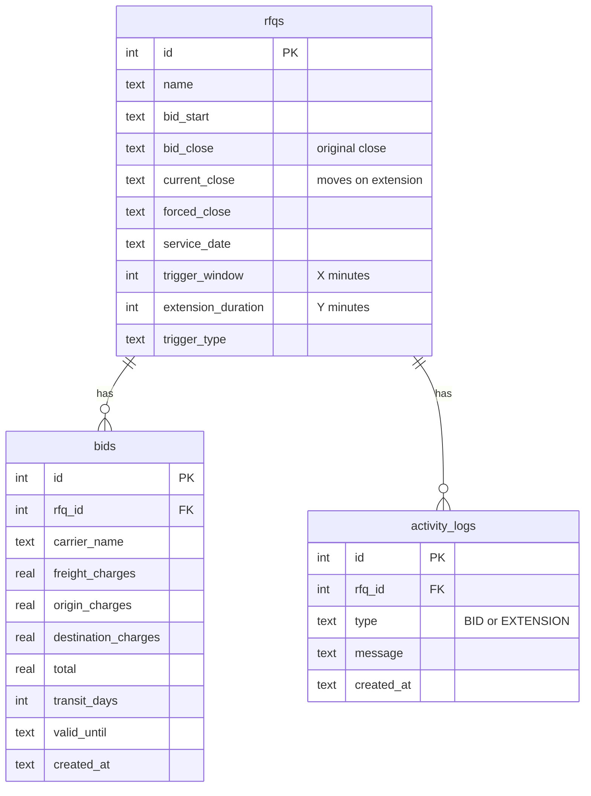

# Database Design

SQL: [schema.sql](../backend/schema.sql)

- Times are UTC ISO strings in one fixed format, so they compare correctly as text.
- Bids are never updated. Ranking uses each supplier's latest row.
- Status is computed, not stored.
