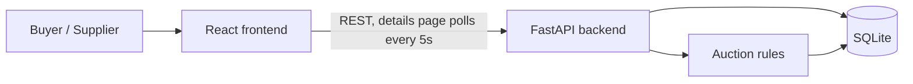
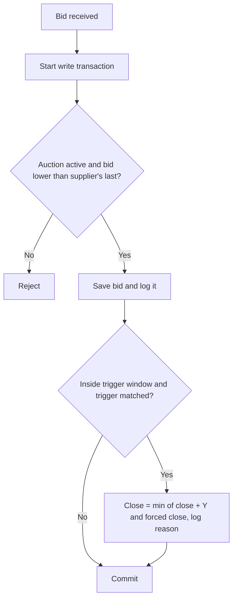

# High Level Design

## Architecture

- **Frontend:** create RFQ, auction listing, auction details with quote form.
- **Backend:** validates input, accepts bids, ranks suppliers, extends auctions.
- **Database:** RFQs, bids and activity log. See [DATABASE.md](DATABASE.md).

## Bid flow

## Rules

- Price = freight + origin + destination charges.
- A supplier is identified by carrier name (trimmed, case-insensitive).
- Ranking uses each supplier's latest bid, lowest first. A tie goes to the earlier bid.
- A supplier's new bid must be lower than their last one.
- Trigger window: `current close - X <= now < current close`.
- Each RFQ has one trigger:
  - `BID_RECEIVED`: any accepted bid.
  - `RANK_CHANGE`: the supplier order changes. A supplier's first bid counts.
  - `L1_CHANGE`: the lowest supplier changes. The first bid overall counts.
- The auction never extends past the forced close time. No log entry is written if the close time does not move.
- Each bid runs in one write transaction, so simultaneous bids are processed one at a time.

## Status

Computed from the current time, so no background job is needed.

| Status | Condition |
|---|---|
| Scheduled | now < bid start |
| Active | bid start <= now < current close |
| Force Closed | now >= current close, and current close = forced close |
| Closed | now >= current close, otherwise |

## Choices

| Choice | Alternative | Why |
|---|---|---|
| SQLite | Postgres | No setup |
| Polling | WebSockets | Less code |
| Plain SQL | ORM | Only three tables |

Not included: login, supplier invitations, awarding a winner.
All times are stored in UTC and shown in the browser's local time.
